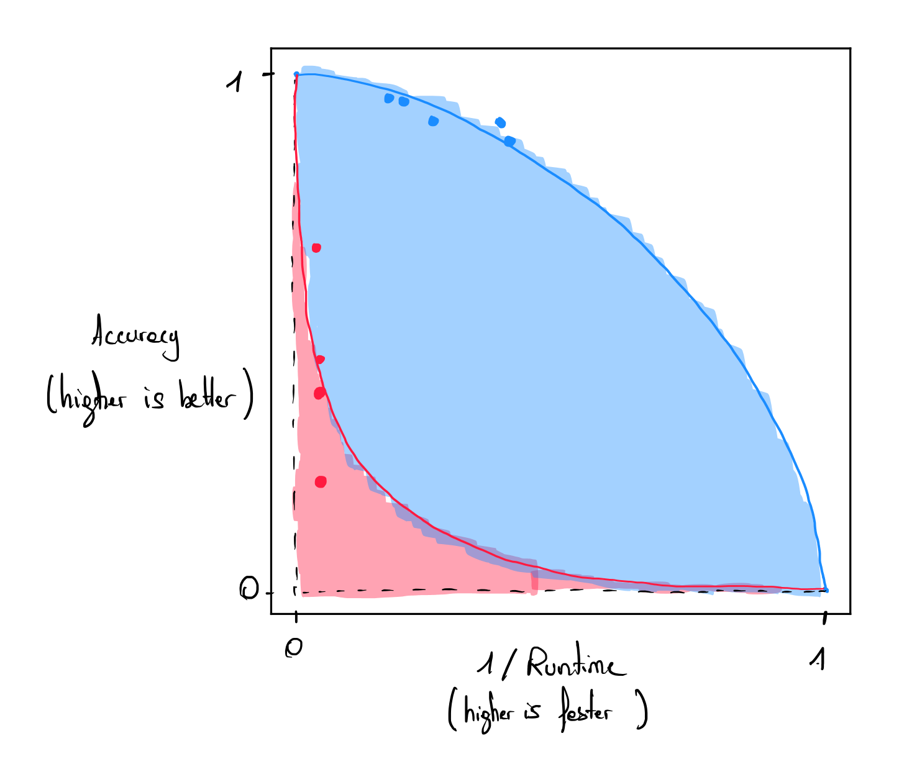
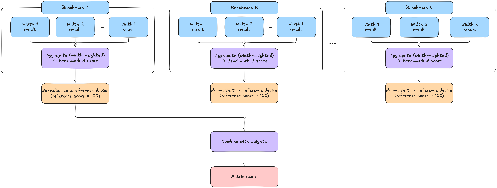

# Aggregated scores

## MYRIAD-Q aggregated figure of merit (2024)

In , F. Barbaresco et al. present a methodology to aggregate benchmarking scores to a single final score according to decision-maker preferences.

### Motivation

The motivations are numerous. The authors claim that existing figures of merit for measuring the performance of quantum computers are too technical and require other methodologies to derive operational indicators of performance associated with quantum computers. To address this gap, the proposed method aims to develop an assessment framework that can serve as a long-term tool for evaluating the performance of quantum computing systems.

### Protocol

The protocol is based on quantum applications across four domains in which quantum computers are believed to offer computational advantages:
- Quantum simulation
- Optimization
- Linear system solving
- Prime factorization

Several figures of merit (also called criteria) are identified for each domain. These figures of merit are then aggregated into a single score using Multi-Criteria Decision Aiding Analysis (MCDA) techniques in accordance with the MYRIAD-Q methodology.  
The first step involves normalizing each figure of merit using a *marginal utility* function. This function maps the values of each criterion onto a common scale within the range $$\mathopen{[} 0, \infty \mathclose{[}$$. For each figure of merit, $$k$$ different values are selected. The decision maker is asked to rank these values in a preferred order $${x_1, x_2, ..., x_k}$$, and to identify the rate of satisfaction for which $$x_i$$ is preferred to $$x_{i-1}$$. A six-level scale quantifies the rate of satisfaction from *very weak gain* to *extreme gain*. The *marginal utility* function $$u_i$$ associated with each criterion is then built, reflecting the subjective preference of the decision maker.  
The second step aggregates the normalized utility values using the two-additive Choquet integral. This approach permits to model potential overlaps between criteria. For instance, a high utility $$u_i$$ in one criterion may strongly correlate with a high utility $$u_j$$ in another. To determine the interaction coefficients required for the Choquet integral, the decision-maker is presented with hypothetical scenarios and asked to express preferences between them, along with corresponding satisfaction levels. An example scenario might ask whether a configuration with a high score in $$u_i$$​ and a low score in $$u_j$$​ is preferable to the inverse. From these comparative assessments, the Choquet integral's parameters are derived algorithmically.

### Limitations

As mentionned by the authors, the MYRIAD-Q score strongly depends on the decision maker subjective point of view, this figure of merit cannot be compared unless the exact same detailed protocol is replicated. 

## Quantum Application Score (QuAS) (2024)

The Quantum Application Score (QuAS)  was introduced by K. J. Mesman et al. in 2024 and aims to define a framework to compute a single score from different Key Performance Indicators (KPIs) chosen by the user when solving an optimization problem.

### Motivation

The motivation for this framework is to establish a protocol that accommodates multiple degrees of freedom with respect to the problem instances being benchmarked and the performance metrics evaluated. The authors aim to facilitate an equitable analysis across the different KPIs being benchmarked using this method.

### Protocol

Suppose we want to track $$d$$ different KPIs. Running a single experiment on a quantum computer gives us $$d$$ values (one for each KPI), where each value can be normalized. The $$d$$ values can be represented in a $$d$$-dimensional space as a single datapoint. If we repeat this experiment for $$k$$ different experiments, we collect $$k$$ different datapoints. Together, these points form a hypersurface in the d-dimensional space. The QuAS score measures the area under this hypersurface, representing the behavior of the quantum computer for these $$k$$ experiments.  
The initial stage of the protocol is dedicated to identifying the set of KPIs relevant to the benchmark study. The authors illustrate this with an example involving three primary KPIs: the problem size, the solution quality, and the runtime of the quantum device. In their example, the quality of the solution obtained with the quantum computer is expressed concerning a reference solution found classically.  
For a fixed problem size, data points are collected using different problem instances and varying runtimes. These data points are then plotted in a two-dimensional plane, where one axis represents solution quality and the other runtime. Both axes are normalized to the $$[0, 1]$$ range. The Pareto front between solution quality and runtime is approximated using Lamé curves (see Figure). Data points of the same color correspond to problem instances of the same size. The area under each curve is computed, with larger integrals indicating better performance. These integrals are summed across all problem sizes (blue and red), giving the final QuAS score. The quantum computer achieving the highest QuAS score is identified as the most effective computer for solving the target problem.

  

Each KPI can be weighted according to the user's choice, and offsets can be added to each quantity to normalize the score. 

### Limitations

As mentioned by the authors, the QuAS score defines a methodology and not a precise setting of KPIs and weights associated with each KPI. Hence, comparing two QuAS scores from different studies cannot be done.  
Each QuAS KPI has to be formulated as a single number to be included in the framework, making it naturally well-suited for single-objective optimization problems. Multi-objective optimization problems can also be included in this framework if there is an ordered relation between the different objectives, making the final solutions comparable. This method is not adapted for problems for which solutions cannot be directly compared.

## Metriq Score (2026)

The Metriq Score (MS)  is a composite score introduced along with the Metriq benchmark suite in 2026 by A. Cosentino et al. at the <a href="https://unitary.foundation" target="_blank">Unitary Foundation</a>. This score combines normalized results from system-level and application-level benchmarking methods.

### Motivation

Individual quantum benchmarks characterize different aspects of performance, making it difficult to compare devices with a single figure of merit. The Metriq Score defines a methodology for merging and aggregating results from different benchmarking protocols into a single scalar score.

### Protocol

The Metriq Score is a composite indicator that aggregates the results of multiple heterogeneous quantum-computing benchmarking protocols into a single scalar score, following the workflow illustrated in the figure below. The aggregation is performed in three stages. First, results obtained at different problem or circuit sizes are combined into a single value for each benchmark (see upper benchmark panels in the figure). Second, each benchmark-level result is normalized against a reference device, which is assigned a score of 100 (orange boxes). A normalized score above 100 indicates better performance than the reference device, while a score below 100 indicates worse performance. Finally, the normalized benchmark scores are combined through a weighted average, with benchmarks probing larger effective circuit widths receiving greater weight (bottom aggregation purple box). In the published version, the authors adopt a scale-aware weighting scheme, in which each benchmark is weighted according to the circuit width being tested, so that benchmarks probing larger circuits contribute more strongly to the final score. Missing benchmark results contribute a score of zero.

  

The resulting score is a weighted aggregation of normalized benchmark outcomes. The choice of reference device and benchmark weights must be stated explicitly to ensure transparency, as both influence the resulting comparison between devices.

### Assumptions and requirements

- **Baseline transparency**: The choice of reference device and its benchmark results must be explicitly documented to ensure transparent and interpretable comparisons.
- **Weighting scheme transparency**: The weighting scheme used to aggregate benchmark scores must be explicitly documented to clarify how each benchmark contributes to the final score.
- **Consistent execution policy**: Benchmark execution conditions, including compilation, optimization, and error mitigation policies, must be comparable across devices, with any differences explicitly documented.

### Limitations

- **Bias toward larger quantum computers**: The current implementation of the Metriq Score assigns greater weight to results obtained on circuits with more qubits. This rule favors larger quantum computers with lower-quality qubits over smaller, higher-quality systems.
- **Benchmark overlap**: Different benchmarking protocols may evaluate overlapping hardware capabilities. Correlations between their results can lead to certain performance characteristics being implicitly overrepresented in the final score.
- **Baseline sensitivity**: Changing the reference device rescales each benchmark subscore by a potentially different factor. Consequently, the relative influence of benchmarks on the composite score can change, potentially altering device rankings even when the underlying benchmarking results remain unchanged.
- **Uncertainty propagation**: The Metriq Score aggregates point estimates without propagating their statistical uncertainties. The authors identify uncertainty propagation as a direction for future work.
- **Limited score comparability**: Metriq Scores computed using different benchmark configurations, weights, or reference devices are not directly comparable.

## References

