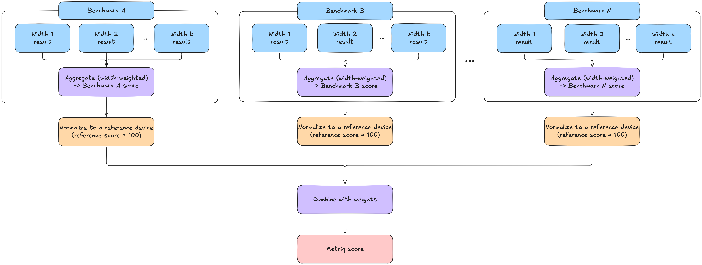

# Metriq Score (2026)

The Metriq Score (MS)  is a composite score introduced along with the Metriq benchmark suite in 2026 by A. Cosentino et al. at the <a href="https://unitary.foundation" target="_blank">Unitary Foundation</a>. This score combines normalized results from system-level and application-level benchmarking methods.

## Motivation

Individual quantum benchmarks characterize different aspects of performance, making it difficult to compare devices with a single figure of merit. The Metriq Score defines a methodology for merging and aggregating results from different benchmarking protocols into a single scalar score.

## Protocol

The Metriq Score is a composite indicator that aggregates the results of multiple heterogeneous quantum-computing benchmarking protocols into a single scalar score, following the workflow illustrated in the figure below. The aggregation is performed in three stages. First, results obtained at different problem or circuit sizes are combined into a single value for each benchmark (see upper benchmark panels in the figure). Second, each benchmark-level result is normalized against a reference device, which is assigned a score of 100 (orange boxes). A normalized score above 100 indicates better performance than the reference device, while a score below 100 indicates worse performance. Finally, the normalized benchmark scores are combined through a weighted average, with benchmarks probing larger effective circuit widths receiving greater weight (bottom aggregation purple box). In the published version, the authors adopt a scale-aware weighting scheme, in which each benchmark is weighted according to the circuit width being tested, so that benchmarks probing larger circuits contribute more strongly to the final score. Missing benchmark results contribute a score of zero.

  

The resulting score is a weighted aggregation of normalized benchmark outcomes. The choice of reference device and benchmark weights must be stated explicitly to ensure transparency, as both influence the resulting comparison between devices.

## Assumptions and requirements

- **Baseline transparency**: The choice of reference device and its benchmark results must be explicitly documented to ensure transparent and interpretable comparisons.
- **Weighting scheme transparency**: The weighting scheme used to aggregate benchmark scores must be explicitly documented to clarify how each benchmark contributes to the final score.
- **Consistent execution policy**: Benchmark execution conditions, including compilation, optimization, and error mitigation policies, must be comparable across devices, with any differences explicitly documented.

## Limitations

- **Bias toward larger quantum computers**: The current implementation of the Metriq Score assigns greater weight to results obtained on circuits with more qubits. This rule favors larger quantum computers with lower-quality qubits over smaller, higher-quality systems.
- **Benchmark overlap**: Different benchmarking protocols may evaluate overlapping hardware capabilities. Correlations between their results can lead to certain performance characteristics being implicitly overrepresented in the final score.
- **Baseline sensitivity**: Changing the reference device rescales each benchmark subscore by a potentially different factor. Consequently, the relative influence of benchmarks on the composite score can change, potentially altering device rankings even when the underlying benchmarking results remain unchanged.
- **Uncertainty propagation**: The Metriq Score aggregates point estimates without propagating their statistical uncertainties. The authors identify uncertainty propagation as a direction for future work.
- **Limited score comparability**: Metriq Scores computed using different benchmark configurations, weights, or reference devices are not directly comparable.

# References

