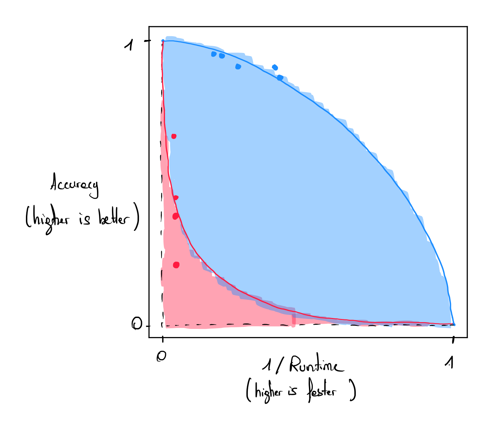

# Quantum Application Score (QuAS) (2024)

The Quantum Application Score (QuAS)  was introduced by K. J. Mesman et al. in 2024 and aims to define a framework to compute a single score from different Key Performance Indicators (KPIs) chosen by the user when solving an optimization problem.

## Motivation

The motivation for this framework is to establish a protocol that accommodates multiple degrees of freedom with respect to the problem instances being benchmarked and the performance metrics evaluated. The authors aim to facilitate an equitable analysis across the different KPIs being benchmarked using this method.

## Protocol

Suppose we want to track $$d$$ different KPIs. Running a single experiment on a quantum computer gives us $$d$$ values (one for each KPI), where each value can be normalized. The $$d$$ values can be represented in a $$d$$-dimensional space as a single datapoint. If we repeat this experiment for $$k$$ different experiments, we collect $$k$$ different datapoints. Together, these points form a hypersurface in the d-dimensional space. The QuAS score measures the area under this hypersurface, representing the behavior of the quantum computer for these $$k$$ experiments.  
The initial stage of the protocol is dedicated to identifying the set of KPIs relevant to the benchmark study. The authors illustrate this with an example involving three primary KPIs: the problem size, the solution quality, and the runtime of the quantum device. In their example, the quality of the solution obtained with the quantum computer is expressed concerning a reference solution found classically.  
For a fixed problem size, data points are collected using different problem instances and varying runtimes. These data points are then plotted in a two-dimensional plane, where one axis represents solution quality and the other runtime. Both axes are normalized to the $$[0, 1]$$ range. The Pareto front between solution quality and runtime is approximated using Lamé curves (see Figure). Data points of the same color correspond to problem instances of the same size. The area under each curve is computed, with larger integrals indicating better performance. These integrals are summed across all problem sizes (blue and red), giving the final QuAS score. The quantum computer achieving the highest QuAS score is identified as the most effective computer for solving the target problem.

  

Each KPI can be weighted according to the user's choice, and offsets can be added to each quantity to normalize the score. 

## Limitations

As mentioned by the authors, the QuAS score defines a methodology and not a precise setting of KPIs and weights associated with each KPI. Hence, comparing two QuAS scores from different studies cannot be done.  
Each QuAS KPI has to be formulated as a single number to be included in the framework, making it naturally well-suited for single-objective optimization problems. Multi-objective optimization problems can also be included in this framework if there is an ordered relation between the different objectives, making the final solutions comparable. This method is not adapted for problems for which solutions cannot be directly compared.

## References

