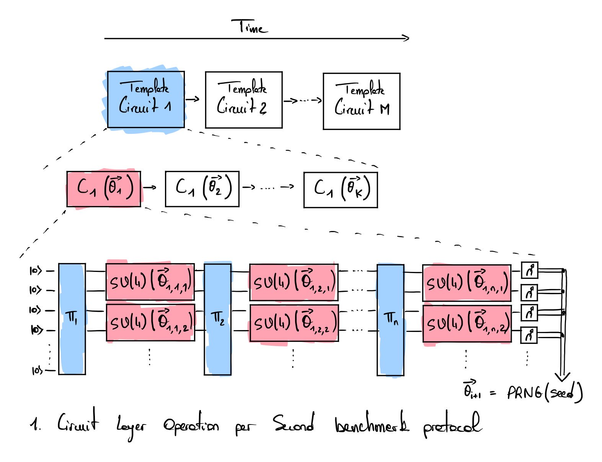





# Circuit Layer Operations Per Second (CLOPS) benchmark

The CLOPS protocol  assesses the execution speed and reliability of a quantum computer in running a series of parameterized square quantum circuits. The original formulation  introduces the $$\mathrm{CLOPS_v}$$ figure of merit, while a subsequent update to the protocol  presented in 2023 defines an alternative figure of merit $$\mathrm{CLOPS_{h.v0}}$$. This subsequent figure of merit has then been lately formalized as $$\mathrm{CLOPS_h}$$ in 2026 in  with differences compared to $$\mathrm{CLOPS_{h.v0}}$$. These figures of merit are reported in the results table for completeness. Reader may notice that both $$\mathrm{CLOPS_{h.v0}}$$ and $$\mathrm{CLOPS_h}$$ are referred to as $$\mathrm{CLOPS_h}$$ in the literature. However, the two protocols differ in several aspects, which is why we distinguish between their definitions here.

**List of acronyms**  
**CE**: Constructor Evaluation (checked if the evaluation is done by the chip manufacturer)  
**SP**: Scientific paper (checked if a scientific paper explain the results)  
**M**: number of templates  
**K**: number of different circuits for each template  
**QV layers**: number of Quantum volume layers (equivalent to $$\log_2 (QV)$$)  



## Motivation

The Circuit Layer Operations Per Second ($$\mathrm{CLOPS_v}$$)  was introduced by IBM in 2021. CLOPS is designed to simultaneously capture three critical aspects of quantum computation: quality, speed, and circuit scale. Specifically, the $$\mathrm{CLOPS_v}$$ quantifies the number of <a href="{{ qv.url | prepend: site.baseurl }}">Quantum Volume (QV)</a> circuits  that a quantum processor can execute reliably per unit of time.

$$\mathrm{CLOPS_{h.v0}}$$ is the variation of the $$\mathrm{CLOPS_v}$$ protocol presented in 2023 and relies on the <a href="{{ eplg.url | prepend: site.baseurl }}">EPLG</a> protocol rather that the Quantum Volume.

A third version called $$\mathrm{CLOPS_{h}}$$ has been formalized in 2026 in . 

## Protocol

The initial protocol detailed in  is based on the <a href="{{ qv.url | prepend: site.baseurl }}">Quantum Volume</a> protocol and defines $$M$$ template circuits. Each template circuit is composed of $$K$$ different real quantum circuits with a set of parameter $$\vec{\theta}_i$$ used to initialize each $$SU(4)$$ gate. The permutation layers $$\pi_i$$ are the same for all the circuits generated from a single template (see Fig. 1).  

  

The intial protocol introduced in  defines the figure of merit $$\mathrm{CLOPS_v}$$ as:

$$\mathrm{CLOPS_v} = \frac{M \times K \times S \times D}{\mathrm{time\_taken}}$$  

where $$M$$ is the number of templates, $$K$$ is the number of simulations done for each template with different parameters for the layers $$SU(4)$$, $$S$$ is the number of shots and $$D=\log_2 QV$$ layers. The initial protocol sets $$M=100$$ and $$K=10$$, which leads to the execution of $$1000$$ different quantum circuits. Each circuit is run with 100 shots. The $$\mathrm{time\_taken}$$ accounts for the total execution time including data transfer to the QC, transpilation of high-level quantum gates to low-level control pulses, qubit measurement and reset time as well as inter-circuit delays.

## Assumptions

- The compilation of each template circuit (high-level compilation and circuit optimization) is not accounted in the measured $$\mathrm{time\_taken}$$.
- For each template circuit, ten parameterized circuits are generatacross all the pairs of qubits. This initied. The parameters $$\vec{\theta}_i$$ for the $$i$$-th circuit are only instantiated once the execution of the $$(i-1)$$-th circuit has been completed.
- Multiple template circuits may be run in parallel on the quantum chip.
- It is essential to specify the quantum volume used in the benchmark to interpret the results. Indeed, a lower quantum volume might lead to a higher CLOPS score.

## Limitations

- The CLOPS score comparison is only meaningful if the same quantum volume is used for all the experiments (this is due to the use of the logarithm of the quantum volume in the computation of the CLOPS score).
- The limits of the quantum volume (e.g., scalability) also apply to the metric $$\mathrm{CLOPS_v}$$.

## Update of the CLOPS protocol ( $$\mathrm{CLOPS_{h.v0}}$$ ) - 2023/11

An update concerning the measurement of CLOPS values has been proposed in  with a new protocol measuring $$\mathrm{CLOPS_{h.v0}}$$ ($$\mathrm{h}$$ meaning hardware). This new protocol changes how layers are considered. In the initial protocol, a layer was defined by a random permutation of all the qubits followed by two-qubit gates (from the $$SU(4)$$ group) across all the pairs of qubits. This initial protocol was favorable for fully connected topologies, which could more easily implement the random permutation than for topologies with restricted connectivity. The new protocol $$\mathrm{CLOPS_h}$$ now relies on the <a href="{{ eplg.url | prepend: site.baseurl }}" target="_blank">EPLG protocol</a> instead of the quantum volume. It splits sequences of gates that cannot be run in parallel into sublayers, artificially inflating the overall number of layers, which tends to increase the value of $$\mathrm{CLOPS_h}$$ compared to $$\mathrm{CLOPS_v}$$ even without any hardware improvement. It has the effect of inflating the CLOPS score for quantum computers that are sparsely connected.

## Update of the CLOPS protocol ($$\mathrm{CLOPS_h}$$) - 2026/08

Another update concerning the measurement of CLOPS values has been formally presented in . 

## Implementations

An implementation of the $$\mathrm{CLOPS_v}$$ based on the quantum volume developed by IQM is available <a href="https://github.com/iqm-finland/iqm-benchmarks/tree/main" target="_blank">here</a>.  
The $$\mathrm{CLOPS_{h.v0}}$$ metric relies on the EPLG protocol. At the time of writing, an implementation of the complete $$\mathrm{CLOPS_h}$$ protocol was not found.

## References
